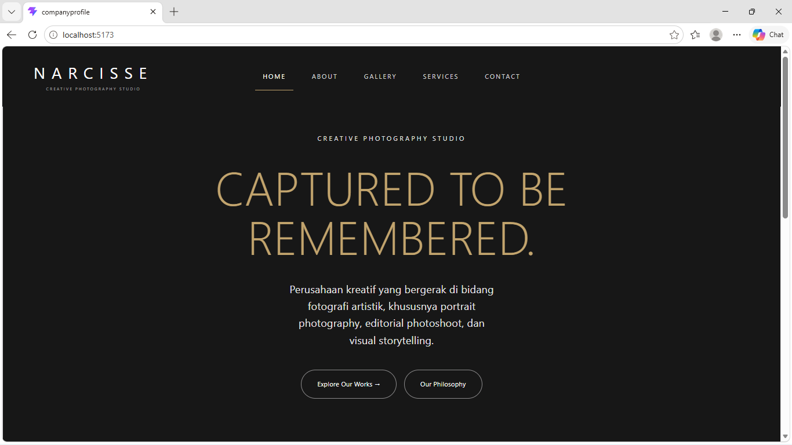
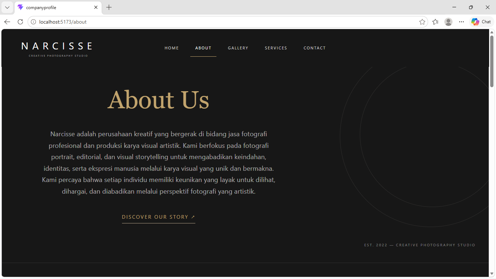
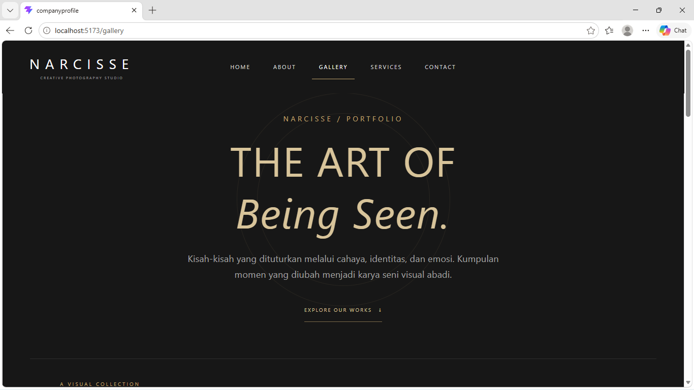
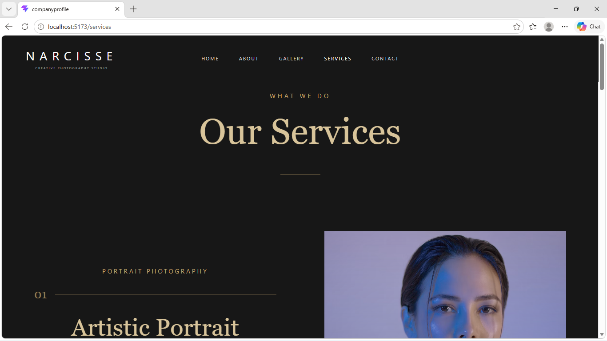
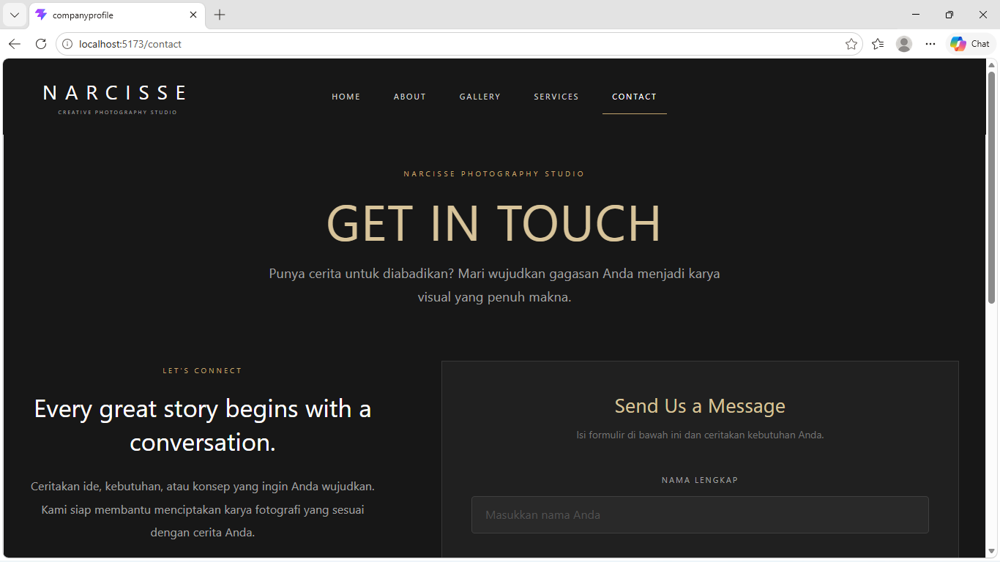

# Company Profile: NARCISSE — Creative Photography Studio

**Nama:** Azmi Triani Putri
**NIM:** 2506473
**Kelas:** Pendidikan Ilmu Komputer

## Deskripsi

NARCISSE merupakan website profil studio fotografi kreatif yang menampilkan informasi mengenai studio, layanan fotografi, galeri karya, serta halaman kontak. Website ini dirancang dengan tampilan elegan dan minimalis untuk memberikan pengalaman visual yang menarik bagi pengunjung.

## Cara Menjalankan

```bash
npm install
npm run dev
```

Lalu buka alamat yang muncul di terminal (biasanya http://localhost:5173/).

## Screenshot

### Home


### About


### Gallery


### Services


### Contact


# React + Vite

This template provides a minimal setup to get React working in Vite with HMR and some ESLint rules.

Currently, two official plugins are available:

- [@vitejs/plugin-react](https://github.com/vitejs/vite-plugin-react/blob/main/packages/plugin-react) uses [Oxc](https://oxc.rs)
- [@vitejs/plugin-react-swc](https://github.com/vitejs/vite-plugin-react/blob/main/packages/plugin-react-swc) uses [SWC](https://swc.rs/)

## React Compiler

The React Compiler is not enabled on this template because of its impact on dev & build performances. To add it, see [this documentation](https://react.dev/learn/react-compiler/installation).

## Expanding the ESLint configuration

If you are developing a production application, we recommend using TypeScript with type-aware lint rules enabled. Check out the [TS template](https://github.com/vitejs/vite/tree/main/packages/create-vite/template-react-ts) for information on how to integrate TypeScript and [`typescript-eslint`](https://typescript-eslint.io) in your project.
